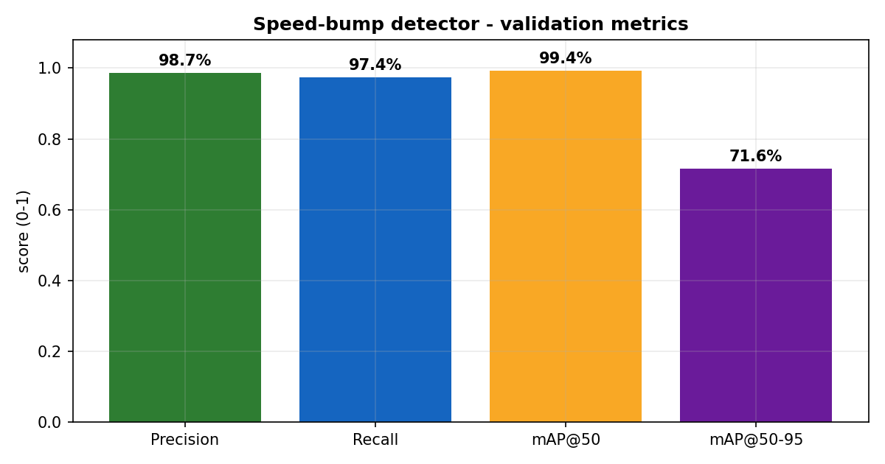
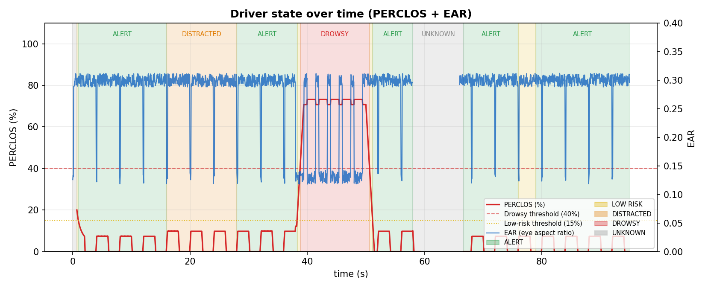
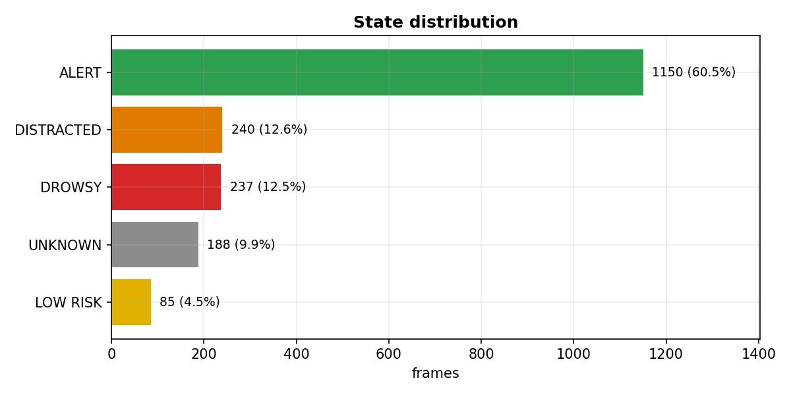

# DrowsyGuard AI - Evaluation Report

*Generated: 2026-10-23 02:40*

## 1. Speed-bump detector (YOLOv8)

| Item | Value |
|---|---|
| Base model | YOLOv8n |
| Image size | 640 |
| Epochs | 50 |
| Validation images | 277 |
| Validation instances | 305 |
| Precision | 98.7% |
| Recall | 97.4% |
| mAP@50 | 99.4% |
| mAP@50-95 | 71.6% |



## 2. Driver-state session

Log: `outputs/simulation_log.csv`

| Metric | Value |
|---|---|
| Frames | 1900 |
| Duration | 95.0 s |
| Drowsy frames | 12.5% |
| Distracted frames | 12.6% |
| Unknown frames | 9.9% |
| Face coverage | 91.6% |
| Mean PERCLOS | 13.8% |
| Max PERCLOS | 73.2% |
| Mean attention | 78 / 100 |

> **Note:** this session is a controlled simulation (`tools/simulate_session.py`). The inputs are scripted; the states come from the project's own `PerclosMeter` and `DecisionEngine`.





## 3. Reproduce

```bash
python -m unittest discover -s tests -t .
python tools/simulate_session.py     # scripted session log
python tools/make_report.py          # rebuild this report
```
